# VIZEN

**Free, open-source overlays for Windows.** Pick any window (a game, a video call, a live chat, a video, a web page),
crop the part you need and keep it on top of your game, in a clean window for OBS, or in a composition.
VIZEN also includes Smart Notes, Smart Draw, a Smart Audio Mixer and an optional browser extension that shows every
Chrome, Edge or Brave tab on its own.

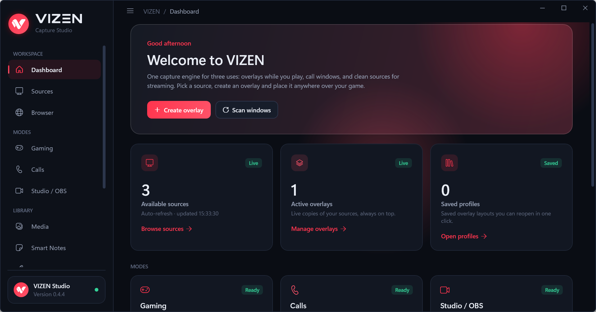

- **Free and open source** (GPL-3.0). No accounts, no ads, no tracking, no servers: everything runs on your PC.
- **Game-safe by design.** VIZEN never injects into games, never reads game memory and never bypasses anti-cheat or
  DRM. It only uses public Windows APIs (see [Games and anti-cheat](#games-and-anti-cheat)).
- **English and Romanian** interface, dark and light themes, five accent colours.

Website: [www.vizen.ro](https://www.vizen.ro) · Contact: [hi@vizen.ro](mailto:hi@vizen.ro)

## Contents

- [Requirements](#requirements)
- [Install](#install)
- [Quick start: your first overlay](#quick-start-your-first-overlay)
- [Tour of the app](#tour-of-the-app)
- [Keyboard shortcuts](#keyboard-shortcuts)
- [Games and anti-cheat](#games-and-anti-cheat)
- [Privacy](#privacy)
- [Known limitations](#known-limitations)
- [Build from source](#build-from-source)
- [Contact](#contact)
- [License](#license)

## Requirements

|  | Minimum | Recommended |
|---|---|---|
| Windows | Windows 10 version 2004 (build 19041) or Windows 11, 64-bit | Windows 11, 64-bit |
| Processor | Intel Core i3-6100 / i3-8130U, AMD Ryzen 3 2200G or newer (4 threads) | Intel Core i5-10400 / i5-8250U, AMD Ryzen 5 3600 / 5500U or newer (8 threads or more) |
| Memory | 8 GB RAM | 16 GB RAM |
| Graphics | DirectX 11 graphics card with hardware acceleration (integrated is fine) | Dedicated graphics card, or a recent integrated one |
| Disk space | 250 MB | 250 MB |
| What to expect | One or two overlays at 720p, 30 fps | Several 1080p sources at 60 fps |

- Microsoft Edge WebView2 Runtime for browser sources (already installed on Windows 11 and on most Windows 10 PCs).
- VIZEN Connector (optional): Microsoft Edge, Google Chrome or Brave, version 116 or later.
- The Performance page in VIZEN measures your own PC and shows which level it reaches.

## Install

**Microsoft Store:** [get VIZEN from the Microsoft Store](https://apps.microsoft.com/detail/9P7K298JRBK2). It is signed by
Microsoft, installs in one click and is updated by the Store.

**Installer** (from GitHub, also linked from [vizen.ro](https://vizen.ro/download)):

1. Download `VIZEN-Setup-x64.exe` from the [Releases](../../releases) page.
2. Run it and follow the steps. Windows asks for administrator permission once, because VIZEN is installed in
   *Program Files*. VIZEN itself then runs as a normal app.
3. Start VIZEN from the Start menu or the desktop shortcut.

The installer version updates itself (vizen.ro, with GitHub as fallback), after you confirm. Use one of the two, not
both. Settings, notes and profiles are saved in your user folder (`%LOCALAPPDATA%\VIZEN`) by both versions. Uninstall
from *Settings → Apps → Installed apps*.

## Quick start: your first overlay

1. Open the window you want to see over your game (for example a video call, a live chat or a video).
2. In VIZEN, open **Sources**. Every open window is listed and sorted into Browsers, Calls, Media, Cameras and Other.
3. Select the window. A live preview appears on the right.
4. Press **Create overlay**. A copy of the window appears on top of everything.
5. Move it by dragging, resize it from its edges, and double-click it to remove black bars.
6. Want only part of the window? Press **Regions…**, draw a rectangle (or several) over the preview and open each
   region as its own overlay.
7. Start your game in **windowed** or **borderless (fullscreen windowed)** mode. The overlay stays on top.
8. Press **Ctrl+Shift+F9** to make the overlays click-through (your clicks go to the game), and **Ctrl+Shift+F10** to
   hide or show them all.

## Tour of the app

### Sources

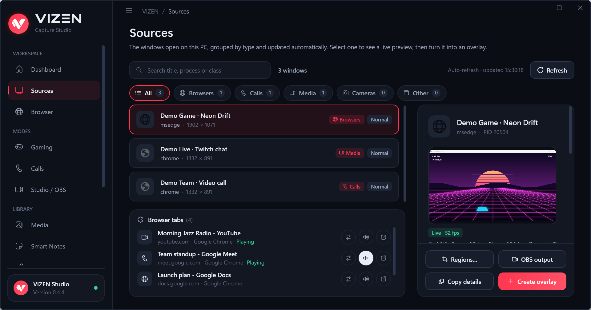

All open windows, refreshed every 3 seconds and grouped by type. Search by title, app or window class. Select a window
to see it live, then turn it into an overlay, an OBS output, or open the region editor to crop it. With the browser
extension, every browser tab also appears here on its own (see [Browser tabs](#browser-tabs)).

### Gaming mode

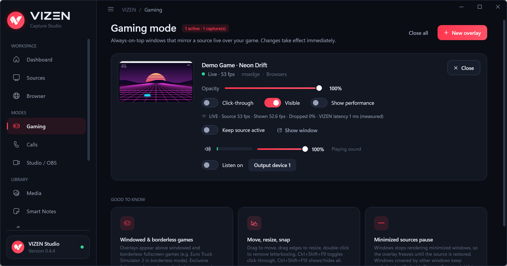

Your open overlays, each with opacity, click-through, visibility and an optional performance readout (measured frames
per second, dropped frames and latency). You can also set the volume of the app behind an overlay and listen to it on
another audio device.

### Calls mode

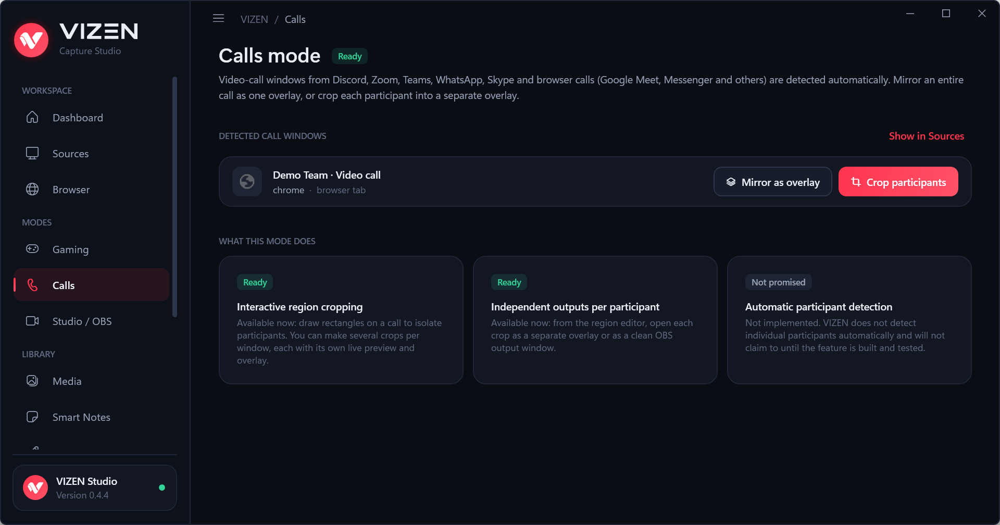

Video calls from Discord, Zoom, Teams, WhatsApp, Skype and browser calls (Google Meet, Messenger and others) are
detected automatically. Mirror the whole call as one overlay, or use **Crop participants** to draw one region per
person and give each one its own overlay or OBS window. VIZEN does not detect participants automatically; you choose
the regions.

### Studio / OBS mode

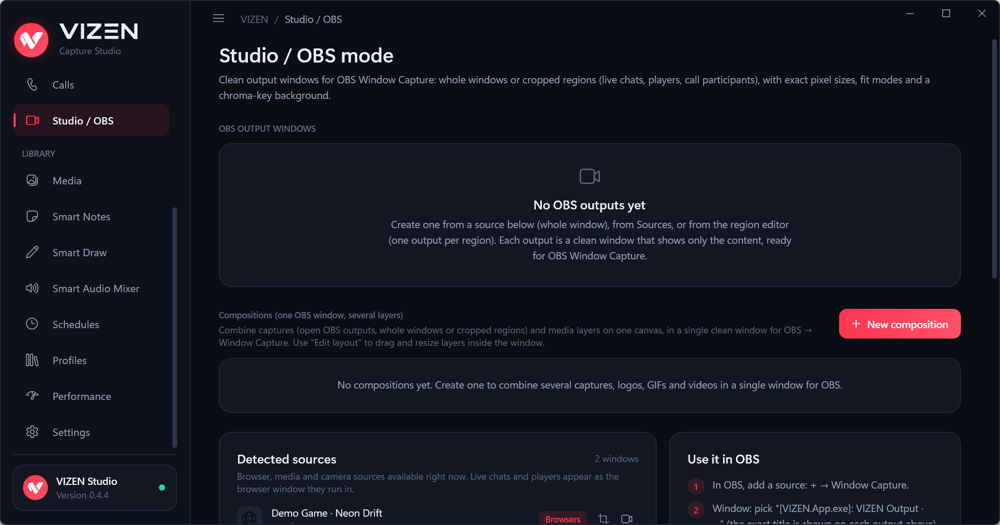

Clean output windows made for OBS **Window Capture**: a whole window or a cropped region, with an exact pixel size,
fit mode and a chroma-key background. **Compositions** combine several captures, logos, GIFs and videos into one
window, so OBS needs only one source.

How to use it in OBS:
1. In VIZEN, create an OBS output from a source (or a region).
2. In OBS, add **Window Capture** and pick `[VIZEN.App.exe]: VIZEN Output · …`.
3. Set the capture method to *Windows 10 (1903 and up)*.

### Browser sources

Open any web page in its own VIZEN window (a YouTube or Twitch chat, an alerts page, a dashboard). It appears in
Sources as "VIZEN Browser", so you can crop it, make it an overlay or an OBS output. The built-in browser is Microsoft
Edge WebView2 with its own profile.

### Browser tabs

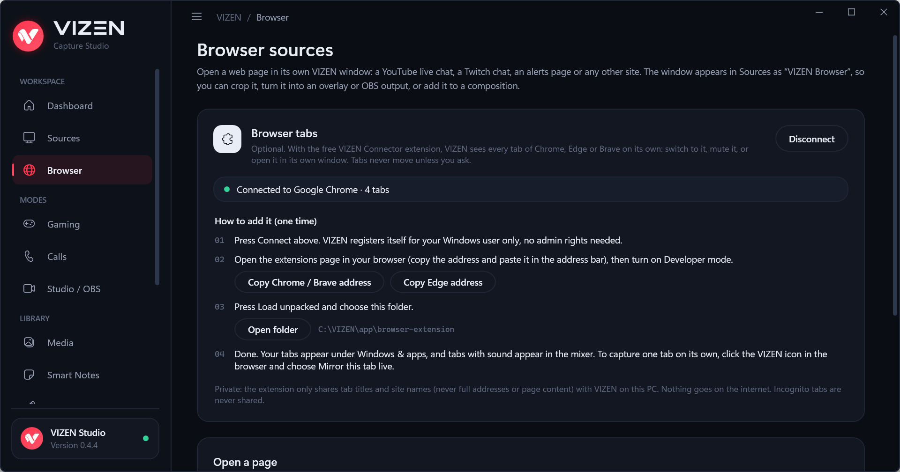

Windows can only capture windows, not tabs. The optional **VIZEN Connector** extension lets VIZEN see every tab on its own. Get it from
the [Chrome Web Store](https://chromewebstore.google.com/detail/eifpggcoejhihbdighpghkacpghehnjb) (Chrome, Brave) or
[Microsoft Edge Add-ons](https://microsoftedge.microsoft.com/addons/detail/gkingdeoabnhbnjpikdmklembdjoplfl):

- every tab appears under **Sources** with its title, site and category;
- **Switch to tab**, **Mute / Unmute** and **Separate window** (moves the tab into its own window, only when you ask);
- tabs that play sound appear in the **Smart Audio Mixer** under their browser, with a mute button
  (browsers have no volume per tab, so VIZEN offers mute only);
- **Mirror this tab live** (in the extension's menu) opens a small window that shows one tab live, even when the tab
  is in the background, ready to be captured. Chrome asks for your permission once for each mirror.

Set it up once:
1. In VIZEN, open **Browser** and press **Connect**.
2. Install VIZEN Connector from the
   [Chrome Web Store](https://chromewebstore.google.com/detail/eifpggcoejhihbdighpghkacpghehnjb) (Chrome, Brave) or
   [Microsoft Edge Add-ons](https://microsoftedge.microsoft.com/addons/detail/gkingdeoabnhbnjpikdmklembdjoplfl).
3. Within 30 seconds VIZEN shows **Connected**. Developers can also load the `browser-extension` folder unpacked.

The extension sends only tab titles and site names (never full addresses or page content) to VIZEN on your PC.
Incognito tabs are never shared. **Disconnect** removes everything VIZEN registered.

### Media & graphics and Schedules

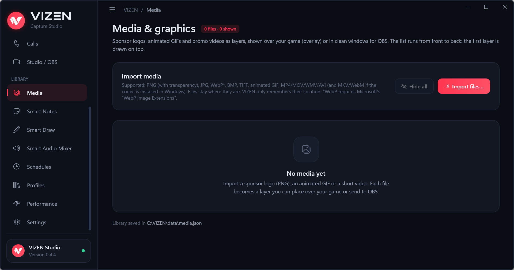

Import sponsor logos (PNG with transparency, JPG, WebP, BMP, TIFF), animated GIFs and short videos (MP4, MOV, WMV,
AVI) and show them as layers over your game or in an OBS window. **Schedules** show them automatically, for example a
logo for 10 seconds every 5 minutes, or a sponsor playlist.

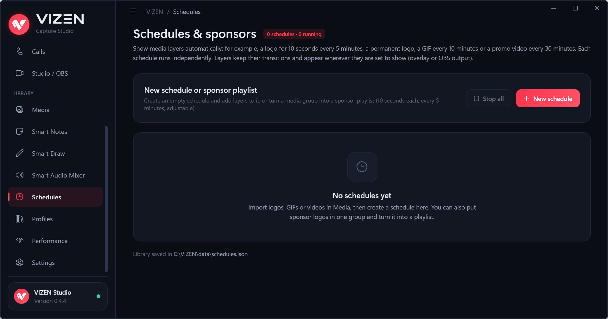

### Smart Notes

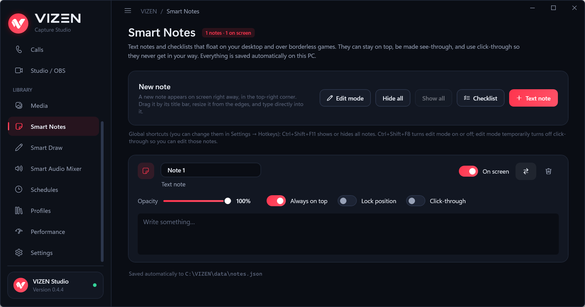

Text notes and checklists that float on your desktop and over borderless games. Each note can stay on top, be
see-through, lock its position and be click-through. **Ctrl+Shift+F11** shows or hides all notes, **Ctrl+Shift+F8**
turns edit mode on or off. Notes are saved automatically.

### Smart Draw

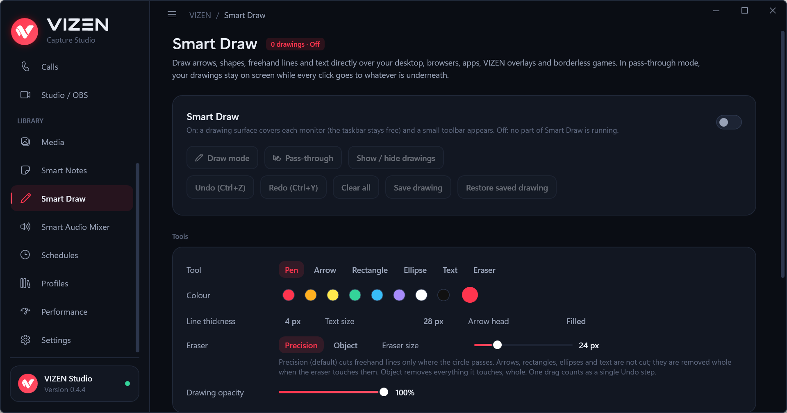

Draw arrows, rectangles, ellipses, freehand lines and text directly over your screen, apps and borderless games.

- **Ctrl+Shift+F7** turns Smart Draw on or off.
- **Ctrl+Shift+F6** switches between drawing and pass-through (your drawings stay, clicks go to the window underneath).
- **Ctrl+Shift+F5** shows or hides the drawings, **Ctrl+Shift+F4** clears them.
- Undo / redo with Ctrl+Z / Ctrl+Y, a precision or whole-object eraser, and save / restore a drawing.

### Smart Audio Mixer

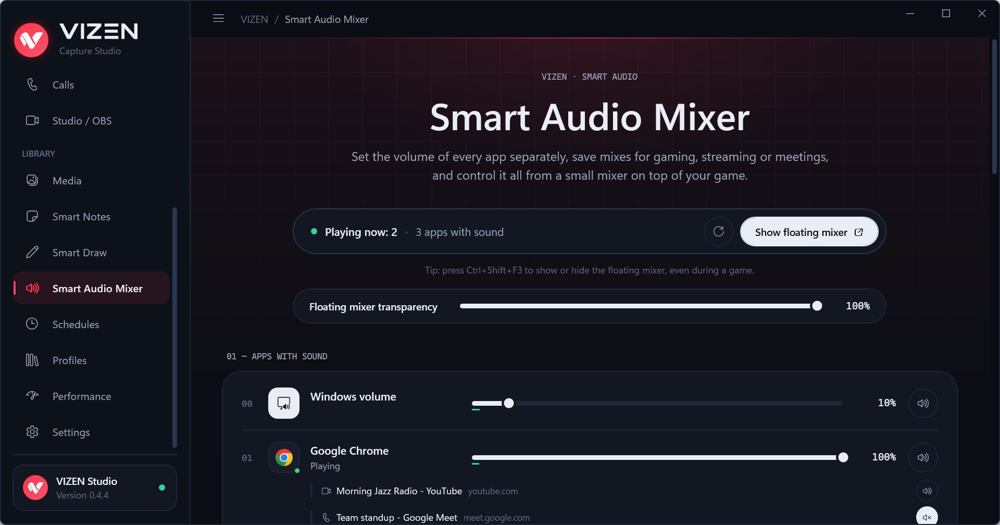

The volume of every app that plays sound, separately, plus the Windows volume (kept in sync with Windows). Save mixes
as profiles (Gaming, Streaming, Meeting, Studio or your own) and control everything from a small floating mixer on top
of your game (**Ctrl+Shift+F3**), with adjustable transparency and size.

**Smart Audio Focus** lowers the apps you choose (music, game) while your priority app (for example Discord) is heard,
then brings them back smoothly. It reacts to how loud the sound is, not to words. Your own volumes are kept and
restored.

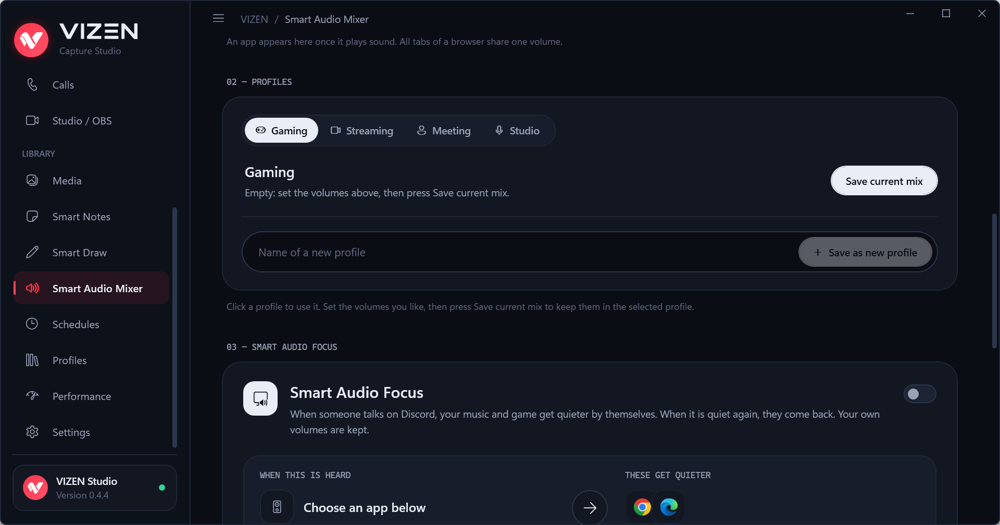

### Profiles

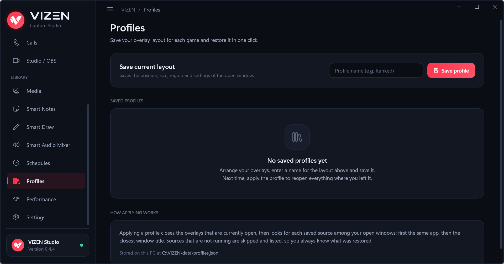

Save the overlays you have open (sources, positions, sizes, settings) under a name, for example one per game, and
reopen them all in one click. VIZEN finds each source again by app and window title and tells you which ones are not
running.

### Performance

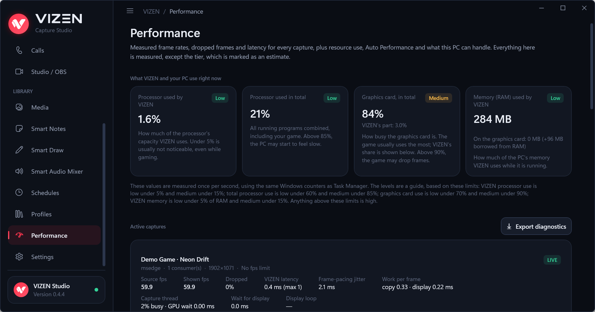

Measured, not guessed: frames per second from the source and on screen, dropped frames, latency and frame pacing for
every capture, plus the processor, graphics card and memory VIZEN uses. **Auto Performance** watches every capture and
tells you the likely cause when frames drop. A test-pattern window lets you measure capture quality on your own PC.

### Settings

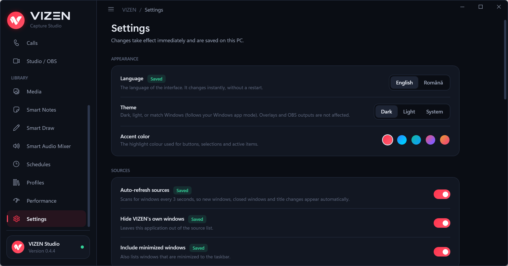

Language, theme and accent colour, source refresh, keyboard shortcuts (all can be changed), launch at sign-in and more.
Changes apply immediately.

## Keyboard shortcuts

All shortcuts work while a game is in front and can be changed in **Settings → Hotkeys**.

| Shortcut | Action |
|---|---|
| Ctrl+Shift+F9 | Overlays: click-through on / off |
| Ctrl+Shift+F10 | Overlays: show / hide all |
| Ctrl+Shift+F11 | Smart Notes: show / hide all |
| Ctrl+Shift+F8 | Smart Notes: edit mode on / off |
| Ctrl+Shift+F7 | Smart Draw: on / off |
| Ctrl+Shift+F6 | Smart Draw: draw / pass-through |
| Ctrl+Shift+F5 | Smart Draw: show / hide drawings |
| Ctrl+Shift+F4 | Smart Draw: clear drawings |
| Ctrl+Shift+F3 | Floating audio mixer: show / hide |

## Games and anti-cheat

VIZEN's overlays are ordinary always-on-top windows, like the ones Discord, Steam or NVIDIA show. VIZEN:

- never injects code into a game, never reads or writes game memory and never automates input;
- never bypasses anti-cheat or DRM protection;
- captures windows with Windows Graphics Capture, the same public API used by the Windows Snipping Tool and OBS.

No one can guarantee how every anti-cheat system decides, because their rules are not public. Details, and the list of
Windows APIs VIZEN uses, are in [docs/GAME_SAFETY.md](docs/GAME_SAFETY.md).

## Privacy

- No account, no telemetry, no network connections of its own (web pages you open in a browser source load as usual).
- Settings, notes, profiles and the media library list stay in `%LOCALAPPDATA%\VIZEN` on your PC.
- The browser extension talks only to VIZEN on the same PC and shares only tab titles and site names.

## Known limitations

- **Exclusive fullscreen games** draw directly to the screen, so no window can appear over them without injecting into
  the game, which VIZEN never does. Switch the game to *Borderless* or *Fullscreen windowed*; VIZEN shows a hint when it
  detects exclusive fullscreen.
- **Minimized windows** are not drawn by Windows, so their overlays pause until the window is restored. Windows covered
  by other windows keep working.
- **Chrome and Edge windows** stop drawing while they are completely covered by other windows (a browser
  optimisation). Use the extension's **Mirror this tab live**, which stays live even when covered.
- **Browser tabs** can be muted from VIZEN, but browsers have no volume control per tab.

## Build from source

Requirements: Windows 10/11, the [.NET 10 SDK](https://dotnet.microsoft.com/download).

```
git clone <this repository>
cd VIZEN
dotnet build VIZEN.App/VIZEN.App.csproj -c Release
dotnet test VIZEN.Tests/VIZEN.Tests.csproj
```

The app is then in `VIZEN.App/bin/Release/net10.0-windows10.0.22621.0/VIZEN.App.exe`.

To build the installer, install [Inno Setup 6](https://jrsoftware.org/isdl.php) and run:

```
powershell -ExecutionPolicy Bypass -File scripts\build-installer.ps1
```

The installer is written to `artifacts/installer/VIZEN-Setup-x64.exe`.

Project layout:

| Folder | Contents |
|---|---|
| `VIZEN.App` | The WPF app (.NET 10): capture, overlays, pages, services |
| `VIZEN.Tests` | Unit and integration tests (xUnit) |
| `browser-extension` | The VIZEN Connector extension (Manifest V3) |
| `installer`, `scripts` | Inno Setup script and build script |
| `docs` | Game safety notes and the screenshots used here |

## Contact

- Website: [www.vizen.ro](https://www.vizen.ro)
- Questions, partnerships and press: [hi@vizen.ro](mailto:hi@vizen.ro)
- Bugs and feature requests: [GitHub Issues](../../issues)

## License

Copyright (C) 2026 kalinvisuals.

VIZEN is free software: you can redistribute it and/or modify it under the terms of the GNU General Public License
as published by the Free Software Foundation, version 3 of the License (GPL-3.0-only).
It is distributed in the hope that it will be useful, but WITHOUT ANY WARRANTY; without even the implied warranty of
MERCHANTABILITY or FITNESS FOR A PARTICULAR PURPOSE. See [LICENSE](LICENSE) for the full text.

In short: anyone may use, study, change and share VIZEN, but whoever distributes it, or a program built from its
code, must do so under the same license and publish the complete source code.

The name "VIZEN" and the VIZEN logo are not covered by this license: a modified version must not be distributed
under the VIZEN name or with the VIZEN logo.

Third-party components keep their own licenses: NAudio (MIT), Microsoft WebView2 SDK (BSD-3-Clause),
System.Diagnostics.PerformanceCounter (MIT); tests use xUnit (Apache-2.0).
