<p align="center">
  
</p>

<h1 align="center">VIZEN</h1>

<p align="center">
  <strong>Live overlays for Windows.</strong><br>
  Put any window, or just a part of it, on top of your game, in a clean window for OBS, or in a composition.
</p>

<p align="center">
  <a href="https://github.com/kalinvisuals/VIZEN/releases/latest"></a>
  <a href="https://apps.microsoft.com/detail/9P7K298JRBK2"></a>
  
  
  <a href="LICENSE"></a>
</p>

<p align="center">
  <a href="https://www.vizen.ro"><b>Website</b></a> ·
  <a href="https://vizen.ro/download"><b>Download</b></a> ·
  <a href="https://apps.microsoft.com/detail/9P7K298JRBK2"><b>Microsoft Store</b></a> ·
  <a href="https://www.vizen.ro/help/"><b>Guide</b></a> ·
  <a href="https://www.vizen.ro/changelog/"><b>What's new</b></a>
</p>

<p align="center">
  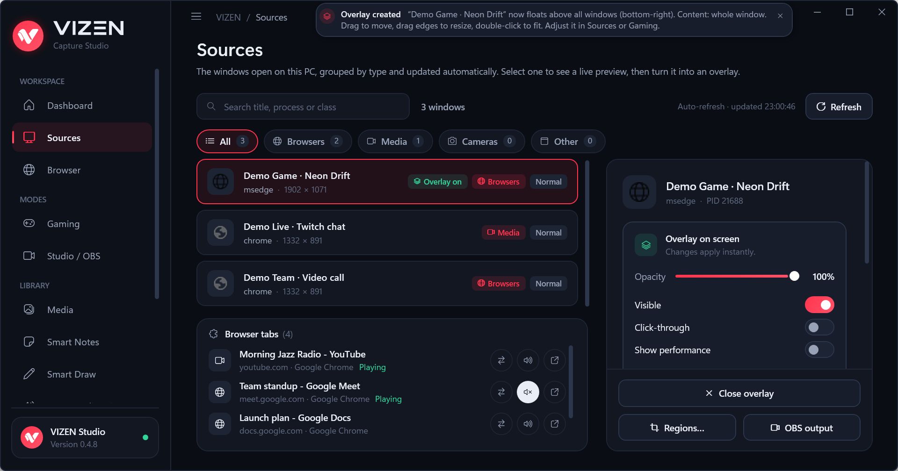
</p>

## Why VIZEN

- **Any window becomes an overlay.** A live chat, a video, a dashboard, a web page or a part of a game: pick it, crop
  it and keep it on top while you play.
- **Made for streamers.** Clean OBS windows with exact pixel sizes, chroma key and compositions, so OBS needs a single
  source.
- **Game-safe by design.** No injection, no game memory access, no anti-cheat or DRM bypass. Only public Windows APIs,
  the same ones the Snipping Tool and OBS use.
- **Measured, not guessed.** Every capture shows its real frame rate, dropped frames and latency.
- **Free and open source.** GPL-3.0, no account, no ads, no tracking, no servers. Everything runs on your PC, in
  English or Romanian, with dark and light themes.

## Features

### 🎮 Gaming overlays

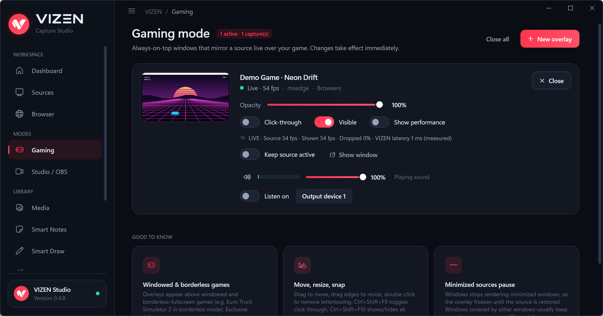

Live, always-on-top copies of any window, over windowed and borderless games. Change opacity, make an overlay
click-through so your clicks reach the game, or hide everything with one key. A small floating bar appears only while
the pointer is on an overlay, together with an optional performance readout. You can also set the volume of the app
behind an overlay and listen to it on another audio device.

### ✂️ Crop any region

Only need the minimap, the chat or the scoreboard? Press **Regions…**, draw one or more rectangles on the live window,
and open each region as its own overlay or OBS window. VIZEN remembers the regions for each app.

### 🎥 Studio / OBS

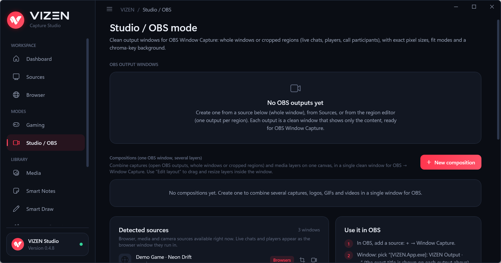

Clean output windows made for OBS **Window Capture**: a whole window or a cropped region, at an exact pixel size, with
fit, fill or stretch and a black or green (chroma-key) background. They play as smoothly as the overlays, and the
close button that appears under the pointer is never recorded by OBS. **Compositions** combine several captures,
logos, GIFs and videos into one window.

1. In VIZEN, select a source and press **OBS output** (or open a region as an OBS window).
2. In OBS, add **Window Capture** and pick `[VIZEN.App.exe]: VIZEN Output · …`.
3. Set the capture method to **Windows 10 (1903 and up)**.

### 🌐 Browser sources and tabs

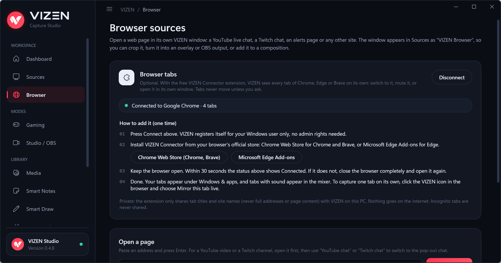

Open any web page in its own VIZEN window: a YouTube or Twitch chat, an alerts page, a dashboard. With the free
**VIZEN Connector** extension for the [Chrome Web Store](https://chromewebstore.google.com/detail/eifpggcoejhihbdighpghkacpghehnjb)
(Chrome, Brave) or [Microsoft Edge Add-ons](https://microsoftedge.microsoft.com/addons/detail/gkingdeoabnhbnjpikdmklembdjoplfl),
every tab appears on its own: switch to it, mute it, move it to its own window, or mirror it live even while it is in
the background.

<details>
<summary>Set up VIZEN Connector</summary>

1. In VIZEN, open **Browser** and press **Connect**.
2. Install VIZEN Connector from your browser's store (links above).
3. Within 30 seconds VIZEN shows **Connected** and lists every tab under **Sources**.

The extension shares only tab titles and site names (never full addresses or page content), and only with VIZEN on
your PC. Incognito tabs are never shared. **Disconnect** removes everything VIZEN registered. Developers can also load
the `browser-extension` folder unpacked.
</details>

### 🎚️ Smart Audio Mixer

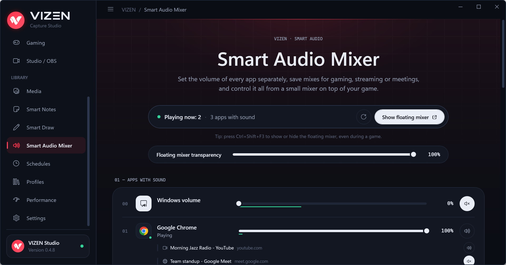

The volume of every app that plays sound, plus the Windows volume. Save mixes as profiles (Gaming, Streaming, Meeting,
Studio or your own) and control them from a small floating mixer over your game (**Ctrl+Shift+F3**).
**Smart Audio Focus** lowers your music and game while the app you choose (Discord, for example) is heard, then brings
them back smoothly.

### ✏️ Smart Draw and 📝 Smart Notes

<table>
  <tr>
    <td width="50%">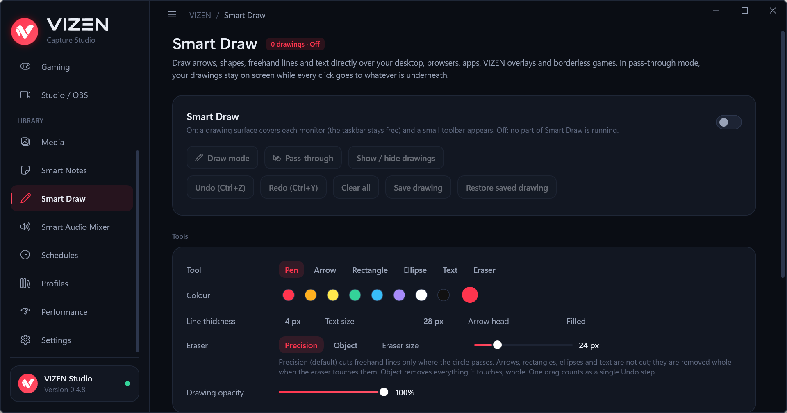</td>
    <td width="50%">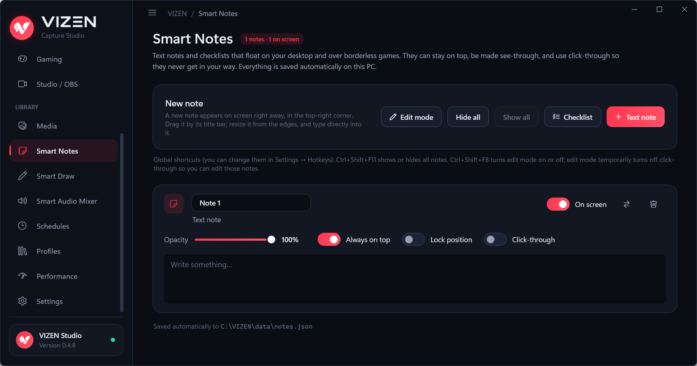</td>
  </tr>
</table>

**Smart Draw**: arrows, shapes, freehand lines and text directly over your screen and borderless games, with
pass-through so clicks reach the window underneath, undo / redo and a precision eraser.
**Smart Notes**: notes and checklists that float on your desktop and over games, with lock, see-through and
click-through. Both are controlled with keyboard shortcuts while you play.

### 🖼️ Media, schedules and profiles

Sponsor logos (PNG, JPG, WebP), animated GIFs and short videos as layers over your game or in an OBS window, shown
automatically by **Schedules** (for example a logo for 10 seconds every 5 minutes). **Profiles** save your open
overlays (sources, positions, sizes, settings) and reopen them all in one click.

### 📊 Performance

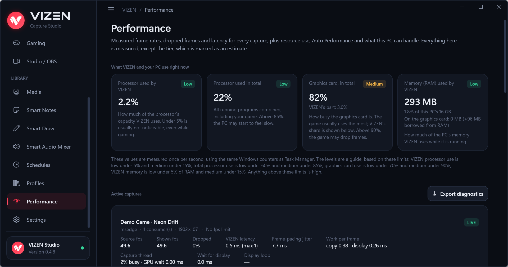

Frames per second from the source and on screen, dropped frames, latency and frame pacing for every capture, plus the
processor, graphics card and memory VIZEN uses. **Auto Performance** explains why frames drop, and a test pattern
measures capture quality on your own PC.

## Screenshots

<table>
  <tr>
    <td>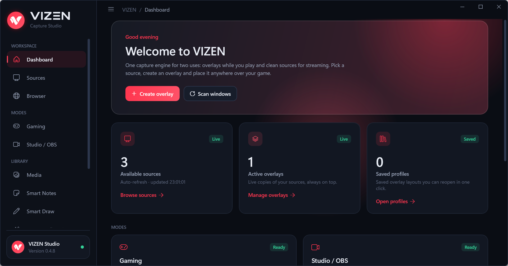</td>
    <td>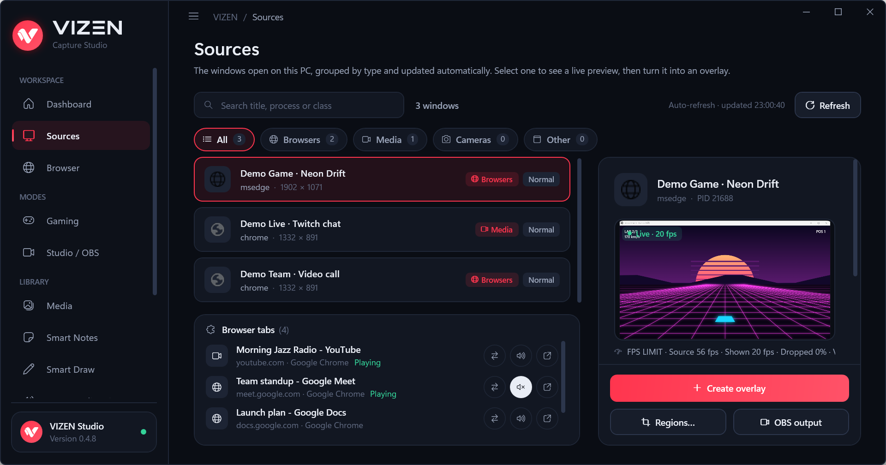</td>
  </tr>
  <tr>
    <td align="center">Dashboard</td>
    <td align="center">Sources</td>
  </tr>
  <tr>
    <td>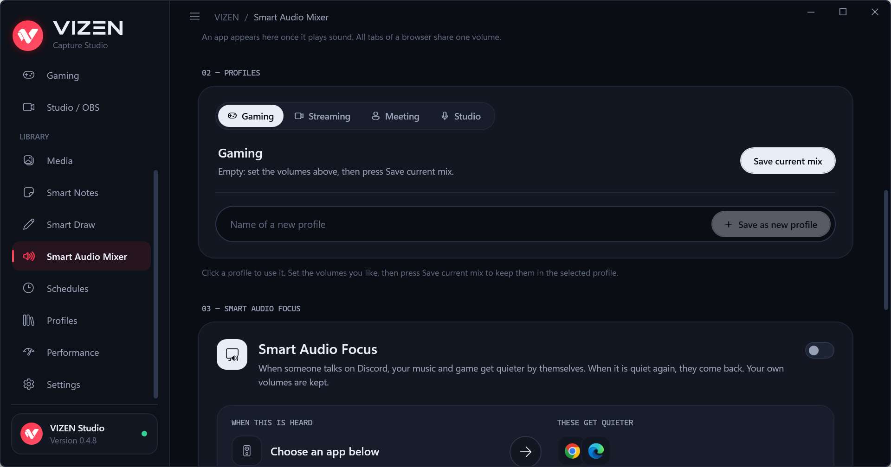</td>
    <td>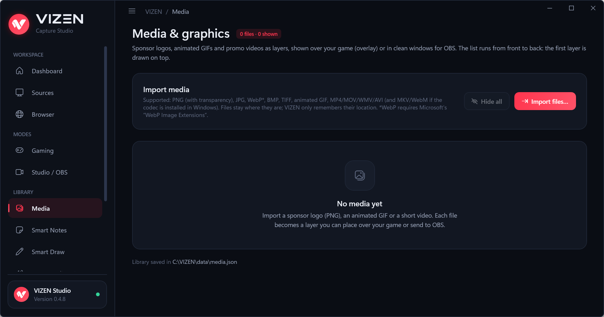</td>
  </tr>
  <tr>
    <td align="center">Smart Audio Focus</td>
    <td align="center">Media &amp; graphics</td>
  </tr>
  <tr>
    <td>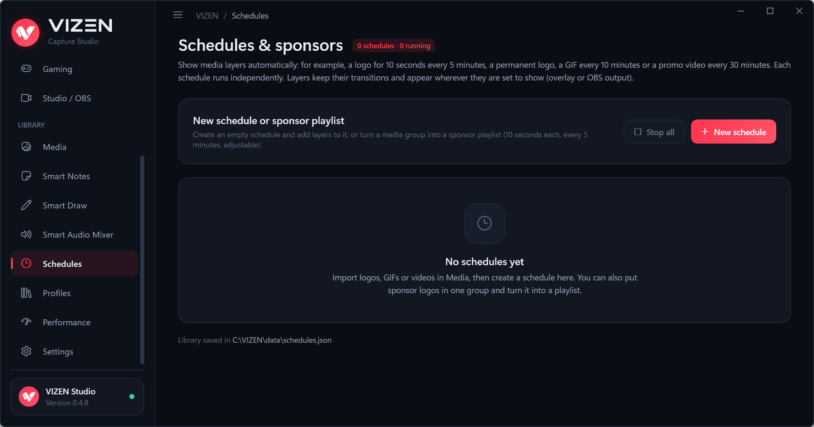</td>
    <td>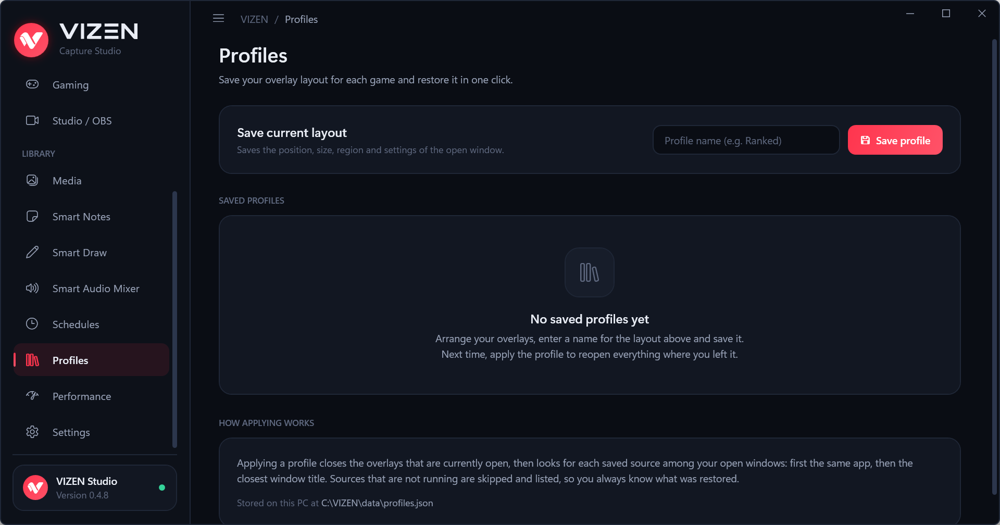</td>
  </tr>
  <tr>
    <td align="center">Schedules</td>
    <td align="center">Profiles</td>
  </tr>
  <tr>
    <td colspan="2">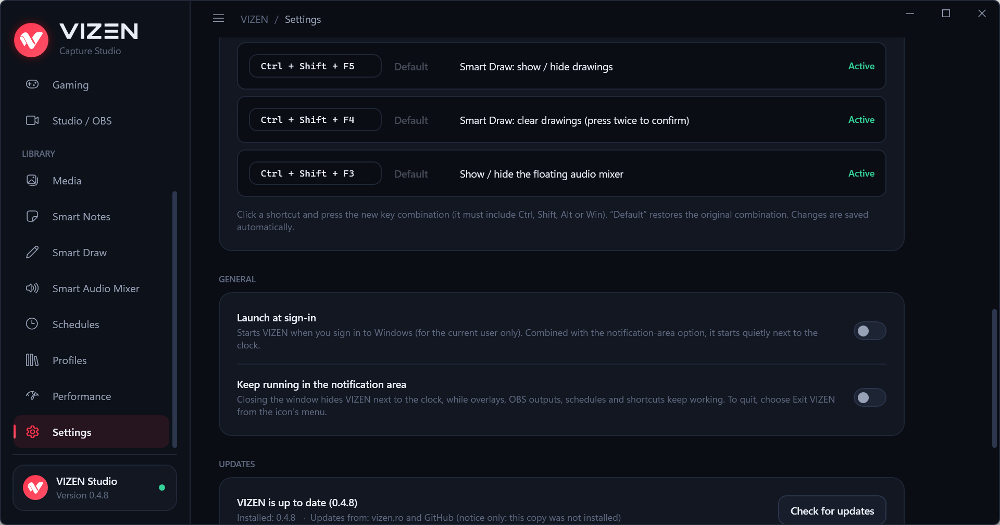</td>
  </tr>
  <tr>
    <td colspan="2" align="center">Settings</td>
  </tr>
</table>

<sub>Screenshots use demo content.</sub>

## Download

| | |
|---|---|
| **Microsoft Store** | [Get VIZEN from the Microsoft Store](https://apps.microsoft.com/detail/9P7K298JRBK2). Signed by Microsoft, installs in one click and is updated by the Store. |
| **Installer** | Download `VIZEN-Setup-x64.exe` from [Releases](https://github.com/kalinvisuals/VIZEN/releases/latest) or [vizen.ro](https://vizen.ro/download). It updates itself (vizen.ro, with GitHub as fallback) after you confirm. |

Use one of the two, not both. Settings, notes and profiles are kept in your user folder (`%LOCALAPPDATA%\VIZEN`) by
both. The installer asks for administrator permission once, because VIZEN is installed in *Program Files*; VIZEN itself
runs as a normal app. Uninstall from *Settings → Apps → Installed apps*.

<details>
<summary>System requirements</summary>

|  | Minimum | Recommended |
|---|---|---|
| Windows | Windows 10 version 2004 (build 19041) or Windows 11, 64-bit | Windows 11, 64-bit |
| Processor | Intel Core i3-6100 / i3-8130U, AMD Ryzen 3 2200G or newer (4 threads) | Intel Core i5-10400 / i5-8250U, AMD Ryzen 5 3600 / 5500U or newer (8 threads or more) |
| Memory | 8 GB RAM | 16 GB RAM |
| Graphics | DirectX 11 graphics card with hardware acceleration (integrated is fine) | Dedicated graphics card, or a recent integrated one |
| Disk space | 250 MB | 250 MB |
| What to expect | One or two overlays at 720p, 30 fps | Several 1080p sources at 60 fps |

- Microsoft Edge WebView2 Runtime for browser sources (already installed on Windows 11 and most Windows 10 PCs).
- VIZEN Connector (optional): Microsoft Edge, Google Chrome or Brave, version 116 or later.
- The Performance page measures your own PC and shows which level it reaches.
</details>

## Quick start

1. Open the window you want to see over your game, for example a live chat or a video.
2. In VIZEN, open **Sources**. Every open window is listed and sorted into Browsers, Media, Cameras and Other.
3. Select the window. A live preview appears on the right.
4. Press **Create overlay**. A copy of the window appears on top of everything, and its settings appear right in the
   panel: opacity, visible, click-through and performance.
5. Drag the overlay to move it, drag its edges to resize it, and double-click it to remove black bars.
6. Start your game in **windowed** or **borderless (fullscreen windowed)** mode. The overlay stays on top.
7. Press **Ctrl+Shift+F9** to make overlays click-through and **Ctrl+Shift+F10** to hide or show them all.

## Keyboard shortcuts

All shortcuts work while a game is in front and can be changed in **Settings → Hotkeys**.

| Shortcut | Action |
|---|---|
| `Ctrl+Shift+F9` | Overlays: click-through on / off |
| `Ctrl+Shift+F10` | Overlays: show / hide all |
| `Ctrl+Shift+F11` | Smart Notes: show / hide all |
| `Ctrl+Shift+F8` | Smart Notes: edit mode on / off |
| `Ctrl+Shift+F7` | Smart Draw: on / off |
| `Ctrl+Shift+F6` | Smart Draw: draw / pass-through |
| `Ctrl+Shift+F5` | Smart Draw: show / hide drawings |
| `Ctrl+Shift+F4` | Smart Draw: clear drawings |
| `Ctrl+Shift+F3` | Floating audio mixer: show / hide |

## Games, anti-cheat and privacy

VIZEN's overlays are ordinary always-on-top windows, like the ones Discord, Steam or NVIDIA show. VIZEN never injects
code into a game, never reads or writes game memory, never automates input and never bypasses anti-cheat or DRM. It
captures windows with Windows Graphics Capture, the public API used by the Windows Snipping Tool and OBS. No one can
guarantee how every anti-cheat system decides, because their rules are not public; details and the list of Windows
APIs VIZEN uses are in [docs/GAME_SAFETY.md](docs/GAME_SAFETY.md).

VIZEN has no account, no telemetry and no network connections of its own (web pages you open in a browser source load
as usual). Settings, notes, profiles and the media library list stay on your PC. See [PRIVACY.md](PRIVACY.md).

## Known limitations

- **Exclusive fullscreen games** draw directly to the screen, so no window can appear over them without injecting into
  the game, which VIZEN never does. Switch the game to *Borderless* or *Fullscreen windowed*; VIZEN shows a hint when it
  detects exclusive fullscreen.
- **Minimized windows** are not drawn by Windows, so their overlays pause until the window is restored. With
  **Keep source active**, VIZEN puts a minimized source back behind the active window so it keeps drawing.
- **Some apps stop drawing while completely covered** by other windows, among them Chrome, Edge and Discord. Keep
  them partly visible or on a second monitor; for a browser tab, the extension's **Mirror this tab live** stays live
  even when covered.
- **Browser tabs** can be muted from VIZEN, but browsers have no volume control per tab.

## Build from source

Requirements: Windows 10/11 and the [.NET 10 SDK](https://dotnet.microsoft.com/download).

```
git clone https://github.com/kalinvisuals/VIZEN.git
cd VIZEN
dotnet build VIZEN.App/VIZEN.App.csproj -c Release
dotnet test VIZEN.Tests/VIZEN.Tests.csproj
```

The app is then in `VIZEN.App/bin/Release/net10.0-windows10.0.22621.0/VIZEN.App.exe`. To build the installer, install
[Inno Setup 6](https://jrsoftware.org/isdl.php) and run
`powershell -ExecutionPolicy Bypass -File scripts\build-installer.ps1`; it is written to
`artifacts/installer/VIZEN-Setup-x64.exe`.

| Folder | Contents |
|---|---|
| `VIZEN.App` | The WPF app (.NET 10): capture, overlays, pages, services |
| `VIZEN.Tests` | Unit and integration tests (xUnit) |
| `browser-extension` | The VIZEN Connector extension (Manifest V3) |
| `installer`, `scripts` | Inno Setup script, build, release and Microsoft Store scripts |
| `website` | The vizen.ro website, guide and changelog |
| `docs` | Game safety notes, update process, release notes and screenshots |

## Contact

- Website: [www.vizen.ro](https://www.vizen.ro)
- Questions, partnerships and press: [hi@vizen.ro](mailto:hi@vizen.ro)
- Bugs and feature requests: [GitHub Issues](https://github.com/kalinvisuals/VIZEN/issues)

## License

Copyright (C) 2026 kalinvisuals.

VIZEN is free software: you can redistribute it and/or modify it under the terms of the GNU General Public License
as published by the Free Software Foundation, version 3 of the License (GPL-3.0-only).
It is distributed in the hope that it will be useful, but WITHOUT ANY WARRANTY; without even the implied warranty of
MERCHANTABILITY or FITNESS FOR A PARTICULAR PURPOSE. See [LICENSE](LICENSE) for the full text.

In short: anyone may use, study, change and share VIZEN, but whoever distributes it, or a program built from its
code, must do so under the same license and publish the complete source code.

The name "VIZEN" and the VIZEN logo are not covered by this license: a modified version must not be distributed
under the VIZEN name or with the VIZEN logo.

Third-party components keep their own licenses: NAudio (MIT), Microsoft WebView2 SDK (BSD-3-Clause),
System.Diagnostics.PerformanceCounter (MIT); tests use xUnit (Apache-2.0).
